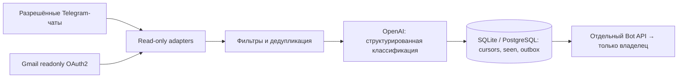

# Архитектура MVP

Один владелец, один worker, одна реплика. Python 3.12. Сначала спроектирована
следующая схема; реализация должна сохранять эти границы.

- Цикл каждые 900 секунд, timezone/дни/часы и категории задаются TOML.
- `mode=synthetic` по умолчанию: нет клиентов внешних сервисов, только встроенные
  вымышленные сообщения и локальный анализатор. Локальные сводки сохраняются в
  SQLite, в stdout только счётчики. Тестовая БД отделена от live.
- Live требует отдельного `ALLOW_LIVE_READS=true` и согласия на передачу текста
  модели `ALLOW_AI_PROCESSING=true`. Telegram дополнительно требует enabled и
  непустой числовой allowlist. Gmail имеет отдельный enabled. Секреты только env.
- Адаптер Telegram использует StringSession в памяти, connect/is_user_authorized,
  никогда start/login/send_message. Каждый чат имеет собственный курсор ID. Явная карта access hashes в runtime secret
  позволяет не перечислять остальные диалоги для разрешения peers.
  Первый запуск устанавливает baseline на текущем последнем ID, не анализирует
  историю. Чаты вне allowlist не запрашиваются.
- Gmail использует только gmail.readonly, refresh token через OAuth2. Первый запуск
  фиксирует historyId профиля; следующие циклы запрашивают messageAdded через
  History API с полной пагинацией и фильтром меток. Продвижение курсора только
  после завершения окна; 404 history требует ручного решения без скрытого сброса. Вложения и HTML не загружаются для анализа.
- Уникальный SHA-256 ключ source/scope/message ID предотвращает повторный анализ.
  Текст исходных сообщений не сохраняется. Результат и seen записываются одной
  транзакцией. Уведомления через durable outbox: сбои доставки не теряют результат.
- Внешние запросы имеют timeout, ограниченные retry; Telegram FloodWait сохраняется в БД, Bot API
  соблюдает retry_after и темп отправки одному владельцу; цикл переживает сбой одного
  источника. Логи содержат только фиксированные коды, без repr(exception).
- Outbox доставляет сводки (категории, рекомендации, договорённости, черновик,
  исходная ссылка) только в заранее заданный личный chat_id владельца. Нет
  команд, вебхуков, входящих HTTP endpoint, инструментов модели и автоответов.
- После успешной доставки чувствительная сводка удаляется через retention_days;
  недоставленные результаты сохраняются для retry. seen и cursors сохраняются
  для дедупликации; политика их очистки требует отдельного решения.
- Схема версионирована Alembic (`0001_initial`); существующий MVP принимается
  только после проверки схемы, без перезаписи данных. Отдельная offline-команда
  переносит SQLite → пустую PostgreSQL с проверкой содержимого и rollback.
- Worker удерживает SQLite flock либо PostgreSQL session advisory lock на свою БД.
  Второй worker отказывает до миграции/чтения источников; перед карточками lease
  connection проверяется. Это защита от случайного overlap, не многорепличная очередь.
- SIGTERM/SIGINT останавливают worker между операциями. SQLite на persistent
  volume; SQLAlchemy обеспечивает тот же контракт на PostgreSQL (psycopg).

## Ограничения консистентности

Exactly-once между Bot API и БД недостижим без idempotency key у Telegram:
если отправка прошла, а подтверждение/commit потерялось, возможен повтор сводки.
В нормальном цикле/после перезапуска дедупликация действует. Один worker обязателен:
для нескольких обрабатывающих реплик нужны distributed claims и fencing. Синхронные Gmail/БД
операции выполняются в последовательном worker; сеть ограничена timeout.

Удалённые/отредактированные сообщения и вложения не синхронизируются. Новое
включение уже ранее разрешённого чата продолжает его сохранённый курсор.
Передача содержимого OpenAI и Telegram-боту — явная часть live-конфигурации.
